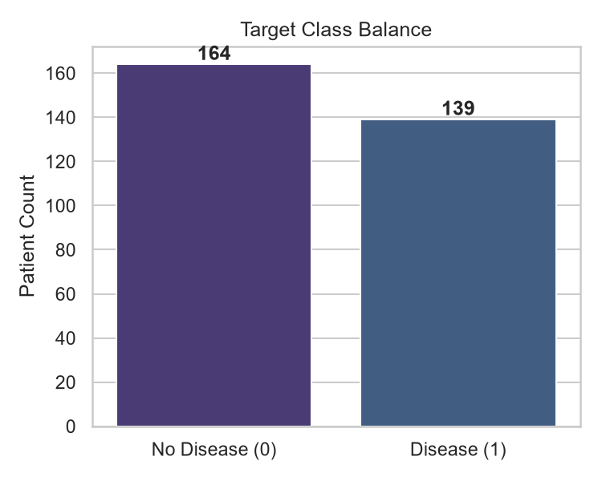
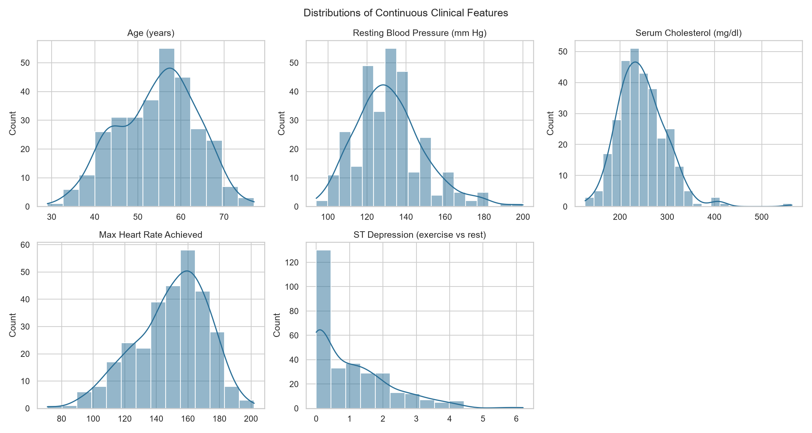
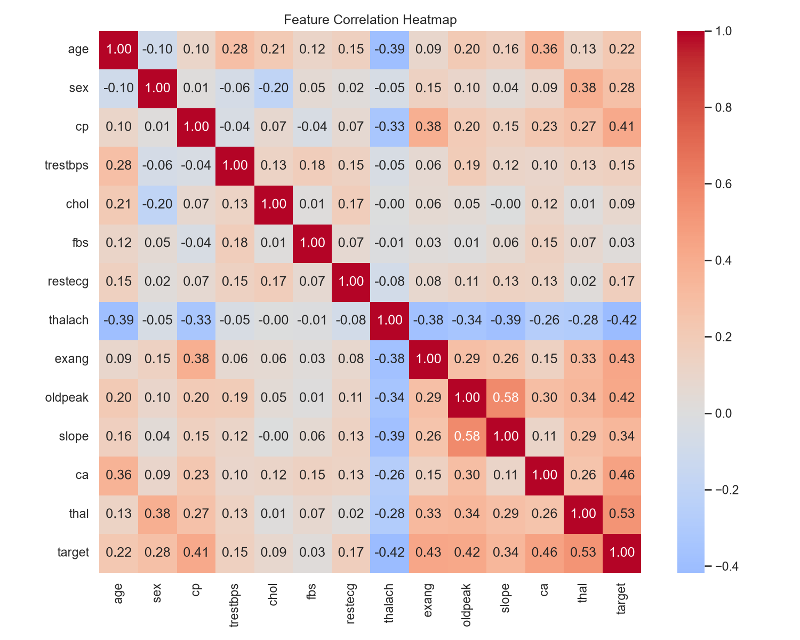
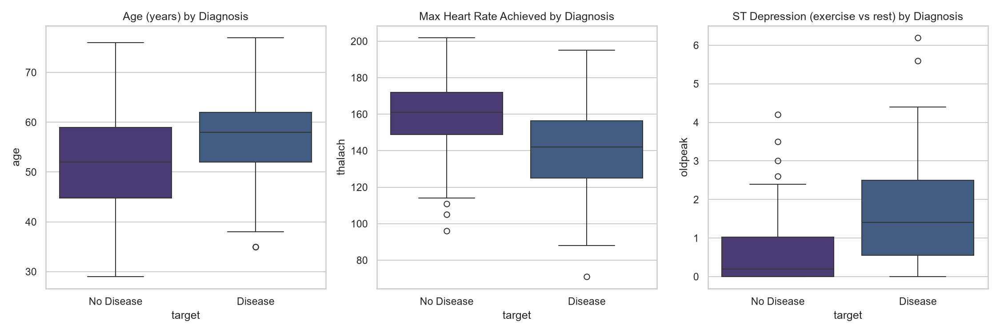
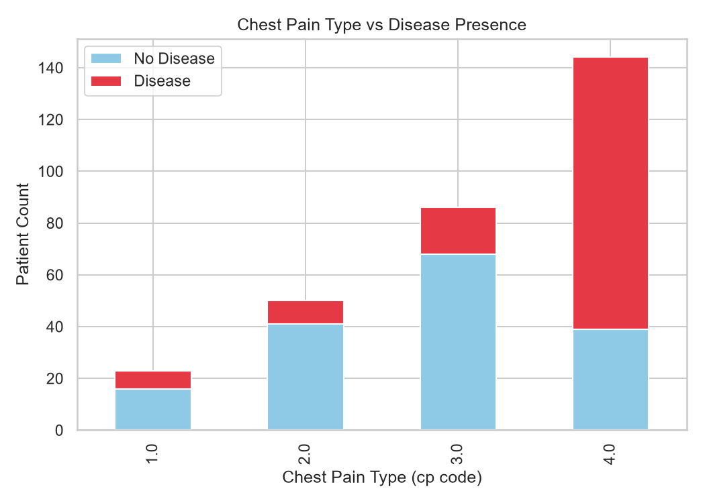
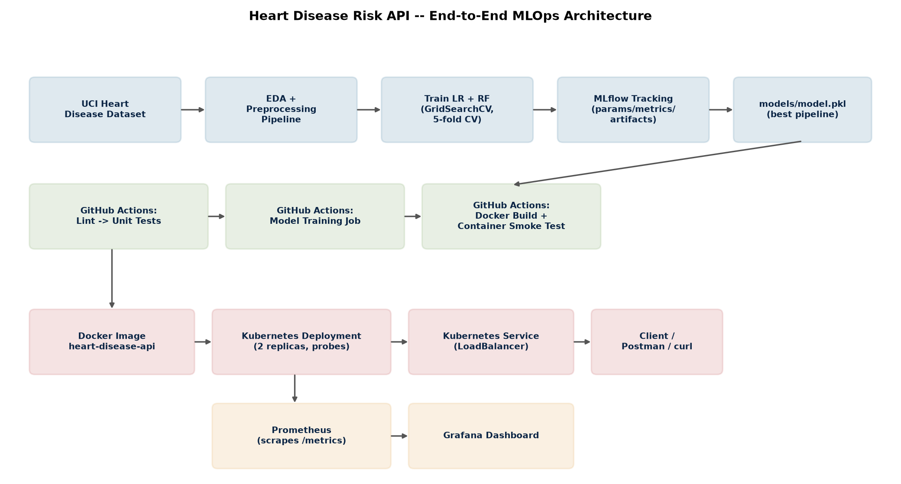

# Heart Disease Risk Prediction: End-to-End MLOps Pipeline

**AIMLCZG523 -- MLOps, Assignment 1**
**Author:** Sowjanya
**Dataset:** Heart Disease UCI Dataset (Cleveland subset), UCI Machine Learning Repository
**Repository:** https://github.com/SaiSowjanyaVadapalli/heart-disease-mlops

---

## 1. Problem Statement

Build a machine learning classifier that predicts the risk of heart
disease from patient clinical data, and deploy it as a cloud-ready,
monitored API. This report documents the full pipeline: data
acquisition, EDA, feature engineering, model development, experiment
tracking, testing, CI/CD, containerization, Kubernetes deployment, and
monitoring.

---

## 2. Setup / Install Instructions

```bash
git clone <your-repo-url>
cd heart-disease-mlops
python -m venv .venv
source .venv/bin/activate              # Windows: .venv\Scripts\activate
pip install -r requirements.txt

python scripts/download_data.py        # acquire + clean the dataset
python notebooks/01_eda.py             # EDA figures + summary
python src/train.py                    # train, track with MLflow, save best model
pytest tests/ -v --cov=src             # run the test suite
```

Full details, including Docker and Kubernetes commands, are in the
project [`README.md`](README.md).

---

## 3. Data Acquisition

`scripts/download_data.py` downloads `processed.cleveland.data` directly
from the UCI Machine Learning Repository
(`archive.ics.uci.edu/static/public/45/heart+disease.zip`), the canonical
source named in the assignment brief, rather than a pre-cleaned
third-party mirror. The file ships with no header and uses `?` for
missing values, so the script:

1. assigns the 14 standard clinical column names (age, sex, cp,
   trestbps, chol, fbs, restecg, thalach, exang, oldpeak, slope, ca,
   thal, num),
2. converts `?` to `NaN`,
3. binarizes the multi-class target `num` (0 = no disease, 1-4 =
   increasing severity) into a binary `target` column (0 = no disease,
   1 = disease present), as required by the assignment.

If UCI is unreachable (e.g. a restricted CI runner), the script falls
back to a mirrored copy of the same Cleveland data so the pipeline never
silently breaks on a network hiccup.

**Resulting dataset:** 303 patients, 14 columns (13 features + target).
Missing values are limited to `ca` (4 rows) and `thal` (2 rows) -- under
2% of the data -- and are handled inside the modelling pipeline (Section
5), not by dropping rows, to preserve every observation.

---

## 4. Exploratory Data Analysis

Generated by `notebooks/01_eda.py` into `reports/figures/`.

### 4.1 Class balance



The target is reasonably balanced (45.9% disease-positive, 54.1%
disease-negative), so accuracy is a meaningful metric here and no
resampling (SMOTE, class weighting) was necessary.

### 4.2 Feature distributions



`chol` (cholesterol) and `oldpeak` (ST depression) are right-skewed with
a handful of high outliers; `age`, `trestbps`, and `thalach` are closer
to normally distributed. This informed the choice of `StandardScaler`
over a method sensitive to extreme skew, plus median (not mean)
imputation for missing numeric values, which is more robust to the
outliers visible in `chol`.

### 4.3 Correlations



The features most correlated with the target are `thal` (0.53), `ca`
(0.46), `exang` (0.43), `oldpeak` (0.43), and `thalach` (0.42) -- all
clinically plausible (thalassemia test result, number of major vessels
affected, exercise-induced angina, ST depression, and max heart rate are
all established cardiac risk indicators). No feature pair showed
problematic multicollinearity (all |corr| < 0.8 between predictors), so
no features were dropped at this stage.

### 4.4 Target vs. key clinical features



Patients with disease tend to be older, have a lower max heart rate
(`thalach`), and show greater ST depression (`oldpeak`) under exercise --
consistent with known clinical presentation.

### 4.5 Chest pain type vs. diagnosis



Asymptomatic chest pain (`cp` = 4) is strongly associated with disease
presence, while typical anginal pain (`cp` = 1) is more common among
disease-negative patients -- a counter-intuitive but well-documented
clinical finding that justified keeping `cp` as a categorical
(one-hot-encoded) rather than ordinal feature.

---

## 5. Feature Engineering & Model Development

### 5.1 Feature engineering (`src/data_processing.py`)

Features are split into two groups and handled by a single
`ColumnTransformer` (fit only on the training split, to avoid data
leakage):

| Group | Features | Treatment |
|---|---|---|
| Numeric | age, trestbps, chol, thalach, oldpeak | Median imputation -> `StandardScaler` |
| Categorical | sex, cp, fbs, restecg, exang, slope, ca, thal | Mode imputation -> `OneHotEncoder(handle_unknown="ignore")` |

Wrapping this in a `ColumnTransformer` nested inside a `Pipeline`
alongside the estimator means the *exact* fitted transformer (medians,
scale factors, one-hot categories learned from training data only) is
serialized together with the model -- the API never needs to
reconstruct feature engineering by hand, which is what makes this
reproducible end-to-end.

### 5.2 Model selection (`src/train.py`)

Two classifiers were trained and compared, as required:

- **Logistic Regression** -- a strong, interpretable linear baseline;
  tuned over `C in {0.01, 0.1, 1.0, 10.0}`.
- **Random Forest** -- a non-linear ensemble that can capture feature
  interactions; tuned over `n_estimators in {100, 200, 400}`,
  `max_depth in {None, 4, 8}`, `min_samples_leaf in {1, 2, 4}`.

Both were tuned with `GridSearchCV` using 5-fold **stratified**
cross-validation (preserving class balance in every fold), optimizing
for **ROC-AUC** since it is threshold-independent and appropriate for a
moderately balanced binary clinical classification task.

### 5.3 Results (held-out 20% test split)

| Model | CV ROC-AUC | Test Accuracy | Test Precision | Test Recall | Test F1 | Test ROC-AUC |
|---|---|---|---|---|---|---|
| Logistic Regression | 0.902 | 0.885 | 0.839 | 0.929 | 0.881 | **0.966** |
| Random Forest | 0.902 | 0.852 | 0.806 | 0.893 | 0.847 | 0.948 |

**Logistic Regression was selected** as the production model: it matched
Random Forest on cross-validated ROC-AUC but generalized better to the
test split (higher test ROC-AUC, accuracy, and recall), and is simpler
and faster to serve. Recall was prioritized as a secondary
consideration over raw accuracy, since in a clinical screening context a
missed positive (false negative) is costlier than a false alarm; Logistic
Regression's 92.9% recall reflects that.

Full metrics (including best hyperparameters per model) are saved to
`reports/metrics.json` by every training run.

---

## 6. Experiment Tracking (MLflow)

Every training run is tracked with MLflow against a local SQLite store
(`mlflow.db` -- the plain filesystem backend is deprecated in MLflow
3.x). Per run, we log:

- **Parameters**: the winning hyperparameters from `GridSearchCV`
- **Metrics**: cross-validated ROC-AUC, and test accuracy / precision /
  recall / F1 / ROC-AUC
- **Artifacts**: confusion matrix plot, ROC curve plot, and the fitted
  sklearn pipeline itself (via `mlflow.sklearn.log_model`)

To browse: `mlflow ui --backend-store-uri sqlite:///mlflow.db`, then open
http://127.0.0.1:5000.

> **[Insert screenshot of the MLflow UI here]** -- showing the
> `heart-disease-risk-classification` experiment with both runs, their
> metrics columns, and one run's artifact view (confusion matrix + model
> files).

---

## 7. Model Packaging & Reproducibility

The winning pipeline (preprocessing + estimator, as one object) is
persisted with `joblib` to `models/model.pkl`. Because preprocessing
lives inside the same `Pipeline` object that was fit and evaluated,
loading this single file and calling `.predict()` on a raw feature dict
reproduces training-time behavior exactly -- there is no separate
"preprocessing script" that could drift out of sync with the model.
`requirements.txt` pins every dependency to the exact version used
during development, and `scripts/download_data.py` makes data
acquisition itself scriptable and reproducible from a clean checkout.

---

## 8. Automated Testing & CI/CD

### 8.1 Unit tests (`pytest`, 14 tests total)

- `tests/test_data_processing.py` -- cleaning (duplicate removal, column
  selection), and the preprocessing pipeline (no NaNs survive
  imputation, numeric features are standardized, unseen categories at
  inference time don't crash the one-hot encoder). Uses synthetic
  in-memory data so this stage never depends on network access.
- `tests/test_model.py` -- pipeline wiring, training, predicted
  probabilities sum to 1, and save/load round-tripping produces
  identical predictions. Uses `sklearn.datasets.make_classification`
  for the same reason.
- `tests/test_api.py` -- FastAPI integration tests (`/health`,
  `/predict` happy path, `/predict` with an out-of-range or missing
  field returns HTTP 422, `/metrics` is exposed). Runs against the
  actually-trained model.

### 8.2 CI/CD pipeline (`.github/workflows/ci.yml`)

Four sequential jobs, each gated on the previous one passing:

1. **lint** -- `flake8` and `black --check`; fails the build on any
   style/syntax error.
2. **unit-tests** -- the offline pytest suite with coverage, uploaded as
   a workflow artifact.
3. **train** -- downloads the dataset, runs EDA, trains + logs to
   MLflow, runs the API integration tests against the freshly trained
   model, and uploads `models/model.pkl` plus `reports/` as artifacts.
4. **docker-build-test** -- downloads the trained-model artifact,
   builds the Docker image, runs the container, polls `/health` with
   retries, and calls `/predict` with a sample payload -- proving the
   model serves correctly from inside an isolated container. Container
   logs are dumped on any failure for debuggability.

> **[Insert screenshot of a green GitHub Actions run here, showing all
> four jobs]**

---

## 9. Model Containerization

`Dockerfile` builds a slim `python:3.11-slim` image that installs
`requirements.txt`, copies `src/`, `api/`, and the trained `models/`
directory, runs as a non-root user, and serves the FastAPI app with
`uvicorn` on port 8000. A `HEALTHCHECK` hits `/health` every 30s.

```bash
python src/train.py
docker build -t heart-disease-api:local .
docker run -p 8000:8000 heart-disease-api:local
curl -X POST http://localhost:8000/predict -H "Content-Type: application/json" -d @sample_request.json
```

Verified response:
```json
{"prediction": 0, "label": "no_disease", "confidence": 0.8146, "model_name": "LogisticRegression"}
```

> **[Insert screenshot of `docker build` + `docker run` + the `curl`
> response here]**

---

## 10. Production Deployment (Kubernetes)

Manifests in `k8s/`:

- **`deployment.yaml`**: 2 replicas, readiness and liveness probes on
  `/health`, CPU/memory requests and limits, so Kubernetes can restart
  unhealthy pods and schedule resources sensibly.
- **`service.yaml`**: a `LoadBalancer` Service, which Docker Desktop's
  built-in Kubernetes exposes directly on `localhost`, and which
  Minikube can expose via `minikube tunnel` or `minikube service --url`.

Step-by-step instructions for both Docker Desktop Kubernetes and
Minikube are in [`k8s/README.md`](k8s/README.md).

> **[Insert screenshots here: `kubectl get pods`, `kubectl get svc`,
> and a successful `curl`/Postman call against the cluster-exposed
> endpoint]**

---

## 11. Monitoring & Logging

- **Structured request logging**: a FastAPI middleware logs every
  request (method, path, status code, latency) as a JSON line to both
  stdout (so `docker logs` / `kubectl logs` capture it) and
  `logs/api.log`; `/predict` calls additionally log the prediction and
  confidence.
- **Prometheus metrics**: `prometheus-fastapi-instrumentator` exposes
  `GET /metrics` with request counts, latency histograms, and
  in-progress request gauges.
- **Dashboarding**: `docker-compose.yml` runs the API alongside
  Prometheus (`monitoring/prometheus.yml` scrapes `/metrics` every 10s)
  and Grafana, so request-rate and latency panels can be built against
  the live API.

> **[Insert screenshot of the Grafana dashboard / Prometheus targets
> page here]**

---

## 12. Architecture Diagram



Data flows left-to-right/top-to-bottom: the UCI dataset feeds EDA and
the preprocessing pipeline, which feeds model training (tracked in
MLflow), which produces `models/model.pkl`. GitHub Actions orchestrates
linting, testing, training, and a Docker build/smoke test, producing the
image that Kubernetes deploys behind a load-balanced Service. Prometheus
scrapes the running pods' `/metrics` endpoint and feeds a Grafana
dashboard.

---

## 13. Summary & Key Decisions

| Decision | Rationale |
|---|---|
| UCI official source over pre-cleaned mirrors | Matches the assignment's named source exactly; keeps raw-data handling (missing values, column naming) as a demonstrated skill rather than inherited from a mirror. |
| ColumnTransformer inside the saved Pipeline | Eliminates train/serve skew -- the API loads one artifact that does imputation, scaling, encoding, and prediction identically to training. |
| Logistic Regression over Random Forest | Comparable CV score, better test-set generalization and recall, simpler to serve and explain. |
| SQLite MLflow backend | The plain filesystem backend is in maintenance mode as of MLflow 3.x. |
| Offline synthetic-data unit tests | Keeps the "lint -> unit test" CI stage fast and independent of network access or a pre-trained model; real-data validation happens in the dedicated "train" stage. |
| FastAPI over Flask | Built-in request/response validation (Pydantic), automatic OpenAPI docs at `/docs`, and native async support. |
| LoadBalancer Service type | Works out-of-the-box with Docker Desktop's Kubernetes and with `minikube tunnel`, without needing an Ingress controller for a single-service local deployment. |

---

## 14. Repository Link

https://github.com/SaiSowjanyaVadapalli/heart-disease-mlops
